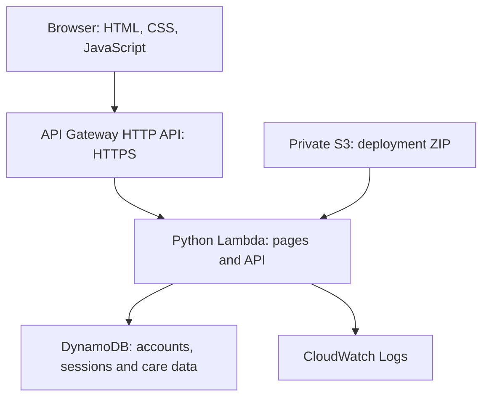

# Architecture and design

## Cloud request flow

S3 supplies deployment code to Lambda. It is not in the web request path. There is no CloudFront distribution or static website hosting bucket. API Gateway forwards every route, including `/`, `/styles.css`, `/app.js` and `/api/*`, to the same Lambda using payload version 2.0.

## Local request flow

Browser → Python ThreadingHTTPServer → shared application service → SQLite.

Only the transport and storage adapters differ. The route logic, validation, passwords, role checks and frontend are shared with the cloud version. The local SQLite file is created under `data/careflow.db`. No local MySQL, MongoDB, DynamoDB emulator or pip packages are needed. Local sessions and accounts survive a restart. AWS starts with a separate, empty database.

## Account permissions

| Operation | Patient | Doctor | Administrator |
| --- | --- | --- | --- |
| Patient self registration | Yes | Not applicable | Not applicable |
| Create doctor account | No | No | Yes |
| View user directory | No | No | Yes |
| View doctors | Yes | Yes | Yes |
| Book appointment | Own account | No | No |
| View appointments | Own | Assigned | All |
| Cancel appointment | Own | Assigned | All |
| Reschedule appointment | Own | No | All |
| Complete visit | No | Assigned, after scheduled time | All, after scheduled time |
| Add consultation record | No | Assigned, after scheduled time | All, after scheduled time |
| Read consultation records | Own | Assigned | All |
| Issue invoice / record manual payment | No | No | Yes |
| View invoices | Own | No | All |

## Data model

A small demonstration dataset is stored in one table. DynamoDB partition key: `pk` (String). The `data` attribute stores a canonical JSON document. Session/rate limit items also have a numeric `expires` attribute for DynamoDB TTL cleanup. Application checks reject expired sessions immediately even before asynchronous TTL deletion. SQLite stores the same key and JSON data in one `items` table.

| Key prefix | Purpose |
| --- | --- |
| `USER#<id>` | User account and password hash |
| `EMAIL#<normalized email>` | Unique email → account ID mapping |
| `META#ADMIN` | One time administrator setup lock |
| `SESSION#<sha256(token)>` | Session owner and eight hour expiry |
| `RATE#<sha256(email)>` | Shared login attempt window |
| `APPT#<id>` | Appointment, status, patient, doctor, time and reason |
| `SLOT#<doctor id>#<time>` | Unique doctor slot reservation |
| `PATIENTSLOT#<patient id>#<time>` | Unique patient slot reservation |
| `RECORD#<id>` | Append only consultation summary and instructions |
| `INVOICE#<appointment id>` | One invoice per appointment, integer amount in paise |

## Consistency

Registration creates the user and unique email mapping together. Administrator setup also claims a unique bootstrap item in that transaction. Concurrent first administrator requests cannot both succeed.

Booking writes the appointment, doctor slot and patient slot atomically. Cancellation changes the appointment and deletes its slot locks in one transaction. Rescheduling atomically releases the old locks and claims new locks; if the new time is taken, the original booking remains intact. Completing a visit preserves its historical slot reservation. Conditional writes check the prior appointment document to prevent stale requests from overwriting a newer state. Adding records and issuing invoices checks the associated appointment in the same transaction.

The local adapter uses SQLite BEGIN IMMEDIATE and rollback. The AWS adapter uses DynamoDB TransactWriteItems and condition expressions. Lists use paginated scans, suitable for this small academic demonstration, rather than a production query/index design.

## Authentication controls and scope

Passwords use PBKDF2 HMAC SHA256 with random salt and 600,000 iterations. Browser sessions use random tokens; only token hashes are stored in the database. Cookies are HttpOnly and SameSite=Strict, with Secure enabled on AWS HTTPS. Sign out deletes the server side session. Mutations require JSON, reject cross site fetch metadata and validate the Origin against the host when present. UI output escapes stored text.

A shared five minute per email window limits login to ten attempts; API Gateway also limits the overall request rate. This is a minimal demo control, not a comprehensive abuse prevention system. Role and ownership checks run on the server independently of which buttons appear in the browser.

The project omits production identity recovery, account management, comprehensive audit trails, consent workflows, backups and healthcare compliance controls. Use fictional data only.
